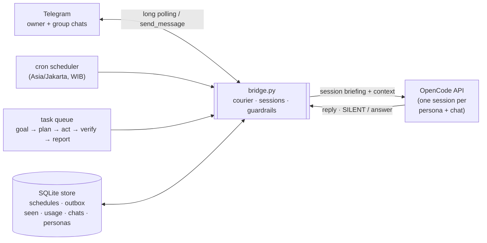

# OpenBridge 🌉

[](https://github.com/sukirman1901/OpenBridge/actions/workflows/test.yml)
[](LICENSE)

**Telegram ⇄ OpenCode autonomous bot bridge** — a self-hosted Telegram bot that pairs with the [OpenCode](https://opencode.ai) API to run an autonomous agent: scheduled cron jobs, self-initiated conversation, a goal-driven task queue, and a silent-by-default etiquette in group chats. Pure Python standard library (no `pip install`), with SQLite as the single source of truth for state.

> Bot names in the configuration (e.g. `Unabot`) are just **sample personas** — this project is open source: clone it, rename the persona and point `config.json` at your own bot token, and make the bot yours. 🤖

## Architecture



The two loops on your phone are lightweight: a per-bot **Telegram thread** (long poll) and **worker threads** (outbox, cron, initiative, task queue) sharing one SQLite database. All persistence goes through `store.py`, so every restart resumes cleanly from where it left off.

## Features

| Module | What it does |
|---|---|
| `bridge.py` | Core Telegram ⇄ OpenCode courier: persistent sessions per (persona, chat), `[SILENT]` mode (legacy `DIAM` still accepted), initiative loop, task loop, daily backups |
| `store.py` | SQLite store (6 tables): schedules, outbox (retry + backoff), seen (offset dedup), usage, chats, personas |
| `scheduler.py` | Cron scheduler: standard 5-field expressions plus legacy `"21:00"` / `"*/N"`, constant **WIB / Asia-Jakarta (UTC+7)** evaluation from epoch |
| `task_queue.py` | Autonomous task queue: goal → plan → act → verify → report |
| `rate_limiter.py` | Per-bot sliding-window call-rate limiter (`max_per_menit` per minute) |
| `usage_meter.py` | Daily per-bot call & token/cost meter with hard budget caps |
| `context_buffer.py` | Per-conversation context buffer (ring of recent turns) |
| `runtime_policy.py` | Guardrails: owner-only policy and permission checks |

## Installation & Setup

OpenBridge is the **bridge**: it sits between Telegram (where you chat) and a running **OpenCode server** (the AI engine). So the setup is: install OpenCode → run its server → point OpenBridge at it → talk to your bot.

### 1. Install OpenCode (the AI engine)

```bash
curl -fsSL https://opencode.ai/install | bash    # macOS / Linux
# or: npm i -g opencode-ai
```

Log in a model provider and start the API server:

```bash
opencode auth login          # pick your provider (Anthropic, OpenAI, …) and paste the key
opencode serve --port 4096   # keep this running — this is OpenBridge's AI engine
```

> `opencode serve` writes its URL and password to `~/.local/state/opencode/service.json`. OpenBridge reads that file automatically — that's the whole "connection" step.
> Running the OpenCode server on another machine/port? Set `OPENBRIDGE_SERVICE_JSON=/path/to/service.json` and OpenBridge will pick it up.

### 2. Create your Telegram bot

1. Message [@BotFather](https://t.me/BotFather) on Telegram → `/newbot` → choose a name (this is **your** bot — `Unabot` here is just a sample) and a username.
2. Copy the token it gives you into a file next to `config.json`:

```bash
echo "123456789:AA..." > mybot.token     # token file only — never inline it in config.json
```

3. Find your **Telegram user id** (message [@userinfobot](https://t.me/userinfobot)) — you'll put it in `owner_ids`.

### 3. Configure & start the bridge

```bash
git clone https://github.com/sukirman1901/OpenBridge.git
cd OpenBridge
```

Edit `config.json` — the important keys:

```json
{
  "bots": [ { "token": "{file:mybot.token}", "nama": "YourBotName", "persona": "…" } ],
  "owner_ids": [123456789],
  "budget":   { "max_call_per_hari": 80, "max_cost_hari": 2.0 },
  "trigger":  { "cooldown_detik": 15, "initiatif_detik": 300 }
}
```

Then start it:

```bash
./start.sh    # bridge keeps running (nohup + pid + lock files)
./stop.sh     # stop it safely (SIGTERM)
```

Now DM your bot on Telegram — it runs the OpenCode agent behind the scenes: chat, `/jadwal` schedules, `/tugas` autonomous tasks, and it politely stays `[SILENT]` in groups unless it makes itself useful. 🤖

> **Termux/Android?** Yes, this is exactly where OpenBridge was born: a phone running OpenCode's server inside Termux plus this bridge can serve a bot 24/7 at zero cost.

## Configure in depth

## Security

- Bot tokens **must never be written in plain text into `config.json`** — always use the `{file:botname.token}` indirection; `*.token` files are excluded by `.gitignore`.
- A single owner is recognized via `owner_ids`; non-owner messages and callbacks are ignored (fail-closed), and destructive actions require owner confirmation in chat.
- Persona edits and deletions are recorded; daily state backups land in `backup/gb-YYYY-MM-DD.tar.gz` (7 kept).

## Structure

```
bridge.py, store.py, scheduler.py, task_queue.py, rate_limiter.py,
context_buffer.py, usage_meter.py, runtime_policy.py
config.json, start.sh, stop.sh
84 unit tests in `test_*.py` — run: python3 -m unittest discover -p "test_*.py"
GOAL.md (master plan, phases 0–5) · AUDIT.md (audit trail)
```

## Development

```bash
python3 -m unittest discover -p "test_*.py"
```

## Roadmap

- [x] Phase 1 — SQLite store + outbox retry + JSON → DB migration
- [x] Phase 2 — Scheduler cron v2 (WIB) + one-shot + interval triggers
- [x] Phase 3 — Autonomous task queue + initiative loop + rate limiter
- [ ] Phase 4 — Cloud host (VPS/box) for 24/7 isolation
- [ ] Phase 5 — Auto-provisioning of new bots (owner confirmation button)

## Contributing

PRs welcome! See [CONTRIBUTING.md](CONTRIBUTING.md) for the ground rules (stdlib-only, no secrets in git, English code) and [SECURITY.md](SECURITY.md) for the private vulnerability-reporting path.

## License

[MIT](LICENSE) — free to use, modify, and distribute. Go build your own bot! 🚀
